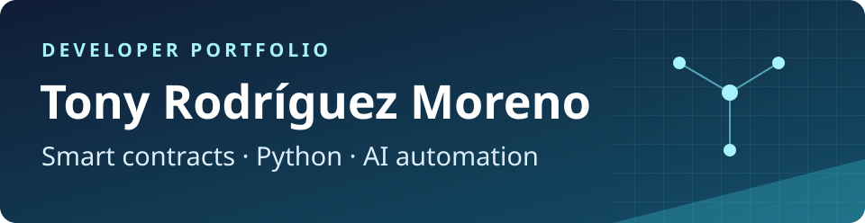

<p align="center">
  
</p>

<p align="center">
  <strong>Solidity &amp; EVM · Python Backend · AI Automation</strong><br>
  📍 Castellón, Spain
</p>

<p align="center">
  <a href="https://github.com/tonyrodriguez-dev/solidity-starter-projects"></a>
  <a href="https://www.linkedin.com/in/tonyrodriguezmoreno/"></a>
</p>

## 👋 About Me

I'm Tony. I build Solidity smart contracts, Python backends and AI workflows. My background in ceramic logistics shapes how I build automation, from validating incoming data to deciding when an exception needs a human review.

```python
tony = {
    "based_in": "Castellón, Spain",
    "building_now": "Smart contract testing with Foundry",
    "working_with": ["Solidity", "Foundry", "Python", "FastAPI"],
    "interests": ["DeFi", "tokenization", "AI agents"],
}
```

## 🚀 Latest Project

### 🔒 Staking App · Tested with Foundry

   

Users deposit a fixed amount of an ERC-20 token and claim an ETH reward each time a staking period passes. The owner funds the rewards. The suite has 18 tests and 100% coverage, with time travel (`vm.warp`), several simulated users and CI on GitHub Actions.

Coverage alone did not convince me, so I broke the contract on purpose 12 times. The tests caught 9. I wrote three more tests to close the gaps (anyone could fund the contract, withdraw did not clear the balance, a missing event), and now all 12 are caught. The repository explains every test, including the weak ones.

[**View repository**](https://github.com/tonyrodriguez-dev/staking-app-foundry) · [**Tests explained**](https://github.com/tonyrodriguez-dev/staking-app-foundry/blob/main/docs/TESTS.md) · [**Contract**](https://github.com/tonyrodriguez-dev/staking-app-foundry/blob/main/src/StakingApp.sol)

### 🏦 Previous project · CryptoBank

A multi-user ETH vault. Each address has its own recorded balance and can withdraw only what it deposited. The admin sets a deposit cap per account, and every withdrawal updates the balance before the ETH is sent (Checks-Effects-Interactions). Built in Remix with eight manual test cases.

[**View repository**](https://github.com/tonyrodriguez-dev/cryptobank-solidity) · [**Manual test cases**](https://github.com/tonyrodriguez-dev/cryptobank-solidity#manual-test-cases) · [**Contract**](https://github.com/tonyrodriguez-dev/cryptobank-solidity/blob/main/CryptoBank.sol)

## 📂 Blockchain Repositories

[**Solidity Starter Projects**](https://github.com/tonyrodriguez-dev/solidity-starter-projects) brings together my contracts for caller identity, access control, ERC-20 and ETH transfers. Start with the [repository layout](https://github.com/tonyrodriguez-dev/solidity-starter-projects#repository-layout) to find the code, or use the [manual test cases](https://github.com/tonyrodriguez-dev/solidity-starter-projects#manual-test-cases) to reproduce a result in Remix.

Also: [**Calculadora Foundry**](https://github.com/tonyrodriguez-dev/calculadora-foundry), a calculator contract with unit tests, a fuzz test and 100% coverage.

[Browse all repositories ↗](https://github.com/tonyrodriguez-dev?tab=repositories)

### Featured projects from the repository

#### 🪙 CryptoReal · ERC-20 token

A Solidity token built with OpenZeppelin. The constructor mints 1,000 CRT to the deployer. The Remix walkthrough shows how to check the balance in base units.

[**View contract**](https://github.com/tonyrodriguez-dev/solidity-starter-projects/blob/main/tokens/CryptoReal.sol) · [**Try it in Remix**](https://github.com/tonyrodriguez-dev/solidity-starter-projects#try-them-in-remix)

#### 🔗 Caller Identity Lab · Connected contracts

Two contracts use an interface to pass a call. The walkthrough follows the caller at each step and reproduces the authorization issue caused by using `tx.origin`.

[**Explore code and walkthrough**](https://github.com/tonyrodriguez-dev/solidity-starter-projects/tree/main/connected-contracts)

#### 💸 ETH Transfers Lab · Payable and call

Two versions show how ETH enters and leaves a contract. A two-account test demonstrates what happens when a withdrawal can spend the shared balance.

[**Explore code and test steps**](https://github.com/tonyrodriguez-dev/solidity-starter-projects/tree/main/eth-transfers)

<details>
<summary><strong>More Solidity projects</strong></summary>

- 🏦 [**My own projects**](https://github.com/tonyrodriguez-dev/solidity-starter-projects/tree/main/my-projects) · Lives counter, vault, piggy bank and a per-customer bank, written by me.
- 🛡️ [**Access Checks Lab**](https://github.com/tonyrodriguez-dev/solidity-starter-projects/tree/main/access-checks) · Compare `revert`, `require` and custom errors.
- 👤 [**Sender**](https://github.com/tonyrodriguez-dev/solidity-starter-projects/tree/main/msg-sender) · Track the difference between a stored owner and the caller.
- 🧮 [**Calculadora**](https://github.com/tonyrodriguez-dev/solidity-starter-projects/blob/main/basics/Calculadora.sol) · Explore state, events and modifiers through arithmetic.

</details>

## 🛠️ Tech Stack

My work spans Solidity smart contracts, Python APIs and AI workflows. The tools below are grouped by where I use them.

### ⛓️ Web3 & smart contracts

    

### ⚙️ Python & backend

  

### 🤖 AI & automation

   

### 🗄️ Data & infrastructure

   

### 🌐 Frontend · Exploring

 

## 🤝 Connect With Me

I'm open to roles in smart contract development, Python backend and AI automation, in Spain or with remote teams.

[**Tony Rodríguez Moreno on LinkedIn ↗**](https://www.linkedin.com/in/tonyrodriguezmoreno/)
